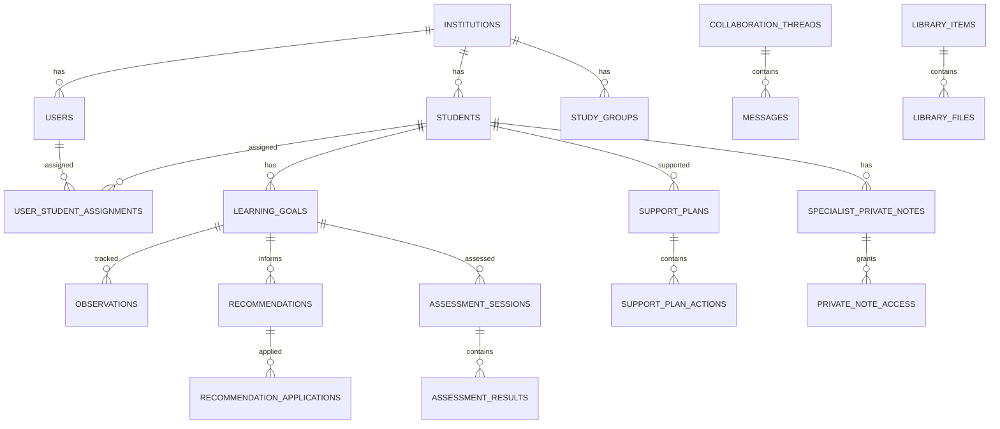

# TEN QADAM

Pilot application for one college, structured so more institutions can be added later. The attached proposal and project document drive the modules and role model. Festival submission instructions are not product requirements. The pedagogical idea describes a proposed model, not validated product outcomes.

## Stack

- Web: React 19, TypeScript, Vite, MUI, Recharts.
- API: NestJS 11 on Node.js 24 LTS, REST under `/api/v1`, OpenAPI at `/api/v1/docs`.
- Database: MySQL 8.4 LTS, Prisma ORM 7, migrations in `apps/api/prisma/migrations`.
- Local services: Docker Compose MySQL and optional MinIO.
- Production: host application, database, object storage, and backups in a Kazakhstan cloud/IDC. Configure a private, encrypted endpoint in Kazakhstan before processing real personal data.

The source screenshot supplies the TEN QADAM brand crop, student illustration, and demo avatar under `apps/web/public/assets`. The dashboard recreates the 1600×900 arrangement and adapts for narrower screens. Kazakh is the default UI language; Russian is available from the header.

## Start locally (PowerShell)

Requirements: Node 24, npm, Docker Desktop. From this directory:

```powershell
Copy-Item .env.example .env
Copy-Item apps/api/.env.example apps/api/.env
Copy-Item apps/web/.env.development.example apps/web/.env.development
# Development-only credentials are in the API example; replace them before shared deployment.
docker compose up -d mysql
npm install
npm run db:generate
npm run db:migrate
npm run db:seed
npm run dev
```

Web runs on `http://localhost:5173`, API on `http://localhost:3001/api/v1`, Swagger on `http://localhost:3001/api/v1/docs`. The development seed inserts fictional accounts with the local-only credentials listed at the end of this file. Production seed requires BOOTSTRAP_ADMIN_PASSWORD explicitly and does not insert sample students.

The default browser configuration signs in against the API and reads the dashboard aggregates from MySQL. Set `VITE_DEMO_MODE=true` only for a browser-only UI preview. Never enter real student data in demo mode. Production builds always use login. Sample student data and fixed role credentials are created only with NODE_ENV=development.

## Modules

The first implementation target from the screenshot is the dashboard page (the panel below the presentation heading at the upper left). The presentation heading and the student-profile, collaboration, and metrics panels are reference-board annotations/other page examples and are not rendered on the home page. The sidebar retains the planned sections; those pages are being implemented incrementally. Planned areas: dashboard; normative documents; student records; teacher guides; learning indicators; individual support plans; specialist collaboration; methodical library and reports. The student workflow is observation → recommendation → application in class → reassessment → support plan update. API CRUD is provided for core student, assignment, observation, recommendation, application, assessment, plan/action, collaboration, library metadata and user workflows.

Current UI and API distinction: some forms are wired to the API (login, student creation, plans status, messages, reports export). Observation, recommendation, assessment, plan/action creation, file upload and private-note editing are represented in API services where implemented or remain next integration work; their UI forms are not yet fully delivered. Library currently exposes metadata; secure object upload/download is a production follow-up. Do not treat demo figures as pilot results.

## Roles and access

| Role | Scope |
| --- | --- |
| Defectologist | Assigned student profiles, goals, recommendations, monitoring, support plan and assignments; may create students and assign specialists. |
| Subject teacher | Students and subjects assigned to them; observations, adapted material, assessment and recording applied recommendations. |
| Pedagogical psychologist | Assigned students; psychological support actions and private notes restricted to the author or explicit access list. |
| Social pedagogue | Assigned students; social support actions and necessary reporting. |
| Administration | User/configuration management and institution-wide aggregates; no personal student-card access. |

Accounts are individual. Roles and student/subject assignments are checked server-side. API data is institution-scoped, the administrator is denied student-level endpoints, and successful authenticated API mutations are written to `audit_logs`. Add review and monitoring for denied requests, login events, exports, and emergency access before production.

## Data model

The Prisma schema and SQL migration are the source of truth. Institution-scoped entities include:

- Organization: institutions, users, roles, user_roles, user_sessions, user_student_assignments.
- Study: students, study_groups, specialties, subjects, student_support_profiles.
- Teaching cycle: learning_goals, observations, recommendations, recommendation_applications, assessment_sessions, assessment_results.
- Support: support_plans, support_plan_actions, specialist_private_notes, private_note_access.
- Collaboration: collaboration_threads, thread_members, messages.
- Resources and privacy: library_items, library_files, data_processing_records, retention_policies, audit_logs, notifications.

Student links to goals, assessments and plans; goals link to subject, observations, recommendations and assessment sessions; a session contains criterion-level results; actions connect responsible specialists and optional goals. Private psychologist notes use a separate access list. Dashboard values derive from recorded assessments and plan actions. Diagnoses and medical records are not collected by default.

Before production pilot, the college must approve the role matrix, lawful processing basis/notice or consent, minimum field set, retention/deletion schedule and incident process. Development/acceptance data is synthetic. Production personal data must be stored in Kazakhstan, with encrypted transport, access-controlled storage, tested backups, and a restore exercise.

## Schema map



## Pilot gates

1. Approve data processing purposes, legal basis, access matrix, minimum fields and retention policy.
2. Set up environments, migration/backup/restore, accounts, session security and audit monitoring.
3. Complete the core pedagogical workflow and secure document storage.
4. Compare the 1600×900 dashboard to the supplied screenshot; review keyboard/mobile behavior and both languages.
5. Load approved pilot records only after sign-off; assess goal completion, recommendation application, event timeliness, adapted-work outcomes, and staff feedback.

Acceptance includes the full workflow; teacher access limited to assigned students/subjects; private notes restricted; administrators see aggregates only; both languages work; actions are audited; and a backup is restored successfully. Storage retention periods are set by the college before real data is loaded.


### Local development logins

These fictional accounts are inserted only when `NODE_ENV=development`. They use a sample student and must not be reused for a shared environment.

| Role | Login | Password |
| --- | --- | --- |
| Administration | admin | TenQadamAdmin2026! |
| Defectologist | demo-defectologist | Defectolog2026!! |
| Subject teacher | demo-teacher | Teacher2026Pass! |
| Pedagogical psychologist | demo-psychologist | Psychologist2026! |
| Social pedagogue | demo-social | SocialPed2026Pass! |


